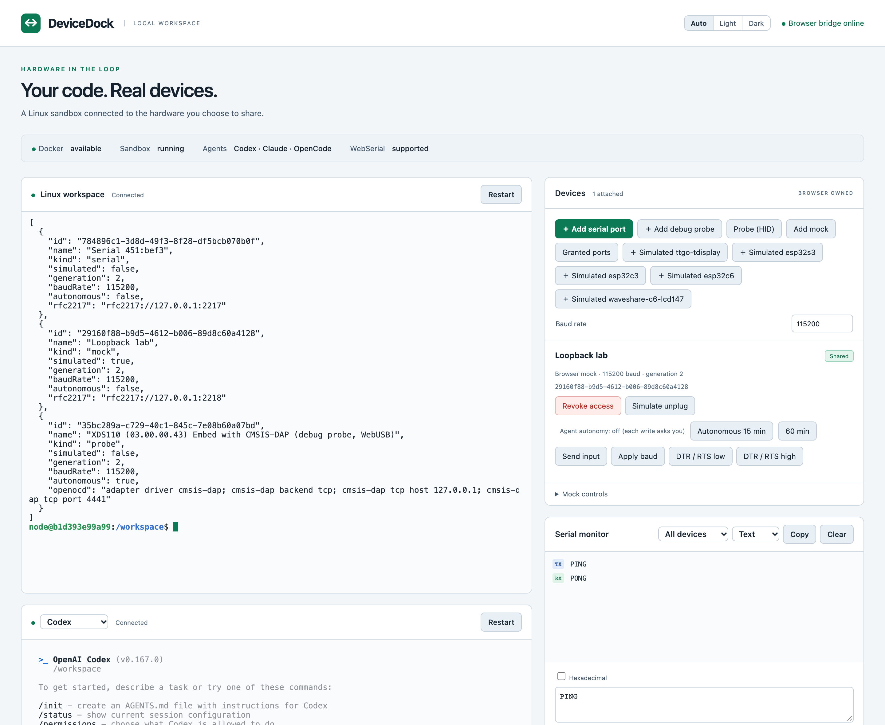

# DeviceDock

A local browser workspace that connects an isolated Linux coding sandbox to browser-owned serial ports. React and xterm.js provide two real Docker terminals; WebSerial and a browser mock share one device protocol, lease manager, and human approval path.



**New here? Read [QUICKSTART.md](QUICKSTART.md).** Five minutes of reading, one command to start (`./devicedock.sh`),
and a worked example that flashes Contiki-NG onto a TI LaunchPad through the browser.

**What works today** (verified on real hardware):
- ESP32 over a shared serial port: esptool enters the bootloader through the bridge (ESP32-D0WDQ6-V3, 2026-11-07).
- TI LaunchPad (CC1352R1) through its XDS110 debug probe over WebUSB: OpenOCD in the sandbox reads, flashes and
  verifies the chip, and the firmware's serial output reaches the sandbox (2026-11-09). About 3 KiB/s.
- Simulated ESP32 boards (esp32sim) as ordinary devices.

Agents in the sandbox get their instructions from [sandbox/AGENTS.md](sandbox/AGENTS.md) (copied to `/workspace`).
The sections below are the full reference.

## Control script

`./devicedock.sh` (no arguments) starts everything and opens an interactive console with live status and restart
commands; see [QUICKSTART.md](QUICKSTART.md#2-start-everything). One-shot forms also work:
`./devicedock.sh start|stop|restart|restart-backend|status|open|logs|login <agent>|build|test|clean`.

## Rust backend (no Node on the host)

`server-rs/` is the host backend rewritten in Rust: one ~13 MB binary with the web UI embedded, a drop-in replacement
for `apps/server` (same HTTP, WebSocket and bridge protocol, same `.runtime/` files, same security rules).
`./devicedock.sh` uses it automatically when it finds `bin/devicedock` or `server-rs/target/release/devicedock`, and
builds it with cargo when Rust is installed. `DEVICEDOCK_BACKEND=node` switches back to the Node backend.

```sh
devicedock serve                     # the backend (what ./devicedock.sh starts)
devicedock open                      # mint a one-time login link and open Chrome
devicedock sandbox start|stop|clean  # the hardened sandbox container
devicedock login-codex               # codex login with the OAuth callback relay
```

Node is now only needed to *develop* the web UI (`npm run build`; the binary serves `./dist` when it exists, else its
embedded copy). Tests: `cargo test --manifest-path server-rs/Cargo.toml` (broker and protocol), then
`npx tsx --test tests/rust/parity.test.ts` (drives the real binary over the wire) and
`node tests/rust/browser-smoke.mjs` (headless Chrome: login, share the mock, PING → PONG). CI
(`.github/workflows/backend.yml`) builds macOS and static Linux binaries; a `v*` tag publishes them as a release.

## Network firewall (Rust backend)

The sandbox has **no network of its own** (`--network none`). Its one way out is `devicedock tunnel`, which the
backend starts inside it with `docker exec` and talks to over that process's stdin/stdout:

```text
 sandbox (--network none)                                       your laptop
 curl / pip / git / claude / codex                              devicedock backend
   └─► HTTPS_PROXY = 127.0.0.1:3128 ─► devicedock tunnel ═══════► firewall: your list? ask? private address?
                                         (docker exec pipe)        └─► connects out from the laptop
 bridge service :47832 ◄──────────────────────────────────────── the backend's device link, same pipe
```

In the page, the **Network** panel sets the mode: **Offline**, **Allow list** (default: AI agents, GitHub and package
registries, embedded toolchains) or **Open**. A connection to a host that is not on the list waits up to 30 s for
your **Allow** or **Block**; Allow adds the host to the list, Block stops asking about it for 10 minutes. The panel
also lists recent connections.

- **Host names only.** An IP address is refused, and so is a name that resolves to a private, loopback,
  link-local or carrier-grade-NAT address: an allowed name can never reach your laptop or your local network.
  Ports 80 and 443 unless an entry names another (`mqtt.example.com:8883`).
- **The rules stay on the laptop** in `.runtime/firewall.json` (mode 0600). Nothing in the sandbox can change them.
- **The tunnel is untrusted.** Any process in the sandbox can write to it, so the backend accepts only proxy streams
  from it, enforces per-stream flow control (256 KiB in flight) and a 256-stream limit, and drops the pipe on any
  protocol error. Killing the tunnel only cuts the sandbox off; the backend restarts it within a second.
- **Measured** on a MacBook with Colima: about 19 MB/s through the tunnel (27 MB/s directly); the device link
  stays responsive during a download.
- **Limits.** It filters by host name, not by content: an allowed host can still receive data. Tools that ignore the
  proxy settings (Node's built-in `fetch`, `git@` SSH URLs, raw sockets) cannot reach the internet. Only the Rust
  backend runs the firewall.
- **Older sandboxes.** The firewall needs an image with `devicedock tunnel` (label `devicedock.tunnel=1`). A sandbox
  created before, or from an older image, keeps its open network and published bridge port, and the panel says so;
  get a current image (console: `i` or `p`) and recreate the sandbox (`rs`).

## Shared folders (Rust backend)

The **Shared folders** panel in the page puts folders from your computer into the sandbox, so agents can work on your
existing projects. **Add a folder…** opens a folder browser that starts in your home folder (or type a path such as
`~/work/my-project`). Each folder appears in the sandbox at `/shares/<folder name>`, read-write unless you tick
**read-only**.

Docker attaches folders only when it creates a container, so a change shows **Restart needed**: **Restart sandbox**
recreates it. Files in `/workspace` and your agent logins are kept (they are volumes); running agents, terminals and
`/tmp` are not. The console's `rs` does the same.

- **What can be shared:** a folder inside your home folder. Never the home folder itself, a hidden folder or
  anything under one (`~/.ssh`, `~/.aws`, `~/.docker`, agent logins), `~/Library`, or a folder that contains
  DeviceDock's own `.runtime`. Links are followed before the check, so a link to `~/.ssh` is refused too.
- **Only the page can change shares** (session plus CSRF token). The sandbox cannot reach this API. The list is kept
  in `.runtime/shares.json`.
- **Agents can change anything in a read-write folder**, including `.git/hooks` and build scripts. Review their
  changes before you run code from the folder on your computer, or share it read-only.
- **Linux:** the sandbox user is UID 1000. If your files belong to another UID the folder may be read-only in
  practice. Docker Desktop and Colima on macOS map ownership for you.

## Node backend (for web UI development)

The original Node backend (`apps/server`) is kept for developing the web UI and as a fallback
(`DEVICEDOCK_BACKEND=node ./devicedock.sh`). It needs Node 22.12+, npm, and Python plus a C toolchain for node-pty
(macOS: `xcode-select --install`). Use `npm ci` (the lockfile is versioned):

```sh
npm ci && npm run typecheck && npm run build && npm test
npm run sandbox:build && npm run sandbox:start
npm start            # backend; `npm run dev` restarts it on source changes
npm run open         # in a second terminal: one-time login link
```

Login links (from `./devicedock.sh` → `o`, `devicedock open` or `npm run open`) open `http://127.0.0.1:47831` with a
one-time token in the fragment. It is removed immediately, exchanged for an HttpOnly SameSite=Strict session cookie,
and never logged. Use this exact host, not `localhost`. Run `npm run build` after frontend changes; the backend serves
the built UI from the same origin. `PORT` changes the browser port. The Node backend reaches the bridge on loopback
port 47832, so it needs a sandbox with a published port (an older image); it does not run the firewall.

## Verify the real container path

1. Add a mock in the browser. It starts **Private**. Leave “Automatic test approval” selected, then click **Open & share**.
2. In the Linux workspace terminal run:

   ```sh
   uname -a
   id
   echo 'created inside Linux' > /workspace/proof.txt
   device list
   /opt/devicedock/node_modules/.bin/tsx /opt/devicedock/sandbox/examples/ping.ts
   ```

3. The example must print `PONG` and confirm binary bytes `00 ff 80 01 0d 0a`. The browser monitor should show TX and RX.
4. Click **Revoke access**. `device list` should no longer show the device. Commands using its old descriptor/lease must fail.
5. Share again, simulate unplug, and share once more. Each sharing creates a new generation and requires a new lease.
6. The agent terminal launches the actual Linux `codex` binary. Until login succeeds it may display authentication/setup prompts; this is not an authenticated agent response.

A UI-only mock test is available with `npm run test:browser` (installed Chrome required). This test does **not** demonstrate the Docker path; perform the steps above separately.

## Agent login (inside the sandbox)

Credentials live only in the `devicedock-home` Docker volume. Nothing is copied from the Mac. A Mac login does not log in the container.

| Agent | Command (run on the Mac) | How it works |
| --- | --- | --- |
| Codex | `npm run login:codex` | Opt-in callback relay (below). Verify with `codex login status` in the sandbox shell. |
| Claude Code | `docker exec -it devicedock-sandbox claude auth login` | Hosted redirect: open the printed URL on the Mac, paste the code back. No relay needed. |
| OpenCode | `docker exec -it devicedock-sandbox opencode auth login` | Provider login; behavior not yet verified here. API-key providers need no callback. |

**Codex relay.** `npm run login:codex` binds Mac `127.0.0.1:1455` only for the duration of one container `codex login`, forwards only `GET /auth/callback` into the container, and never logs request contents. It exits if port 1455 is taken (for example by a Mac Codex login; it will not touch that process), when the login ends, or after 10 minutes. Forwarding was tested with a stand-in listener; a real OAuth round trip still needs a human to complete the browser login.

To log out: `docker exec devicedock-sandbox codex logout` / `claude auth logout`, or remove the `devicedock-home` volume.

## Agent authentication and MCP

From the Linux workspace terminal:

```sh
codex login status
codex mcp add devicedock -- /opt/devicedock/node_modules/.bin/tsx /opt/devicedock/packages/mcp-server/index.ts
```

Restart the agent terminal after configuration. Credentials stay inside the dedicated `devicedock-home` Docker volume. Host authentication files and the Docker socket are never mounted into the sandbox.

The stdio MCP server exposes discovery, acquisition/release, connect/disconnect, read/write, configure, and signal tools. MCP and CLI requests use the same SDK and backend authorization path. There is no HTTP MCP listener. MCP tools return explicit errors for missing leases and denied approvals.

## Device use

**Add serial port** invokes the browser's chooser only on your click. **Granted ports** discovers previously authorized ports without opening them. Opening and sharing a physical port asks you to acknowledge that serial bytes may change hardware state. Every agent-originated physical operation—including writes, configuration, signals, and disconnect—then requires a separate human approval.

Only use known safe commands for an identified board. The bridge does not classify arbitrary serial bytes as safe or detect firmware flashing. Unsupported flashing protocol operations are rejected.

The UI offers baud changes, text/hex input, a text/hex monitor, DTR/RTS high and low controls, revocation, and explicit close. The SDK/MCP also accept parity, data/stop bits, hardware flow control, and break signals. Device support for settings and signal changes varies. The mock supports deterministic echo, `PING` → `PONG`, five-second telemetry, latency, injected errors, unplug, baud configuration, and signal state.

```sh
# Inside the container:
device list
device connect DEVICE_ID --baud 115200
device send DEVICE_ID --text 'PING'
device send DEVICE_ID --hex '50 49 4e 47 0a'
device signals DEVICE_ID --dtr false --rts false
device monitor DEVICE_ID
device disconnect DEVICE_ID
```

Each CLI command acquires and releases its own exclusive lease. A monitor currently holds that lease; another command cannot write concurrently. Use `DeviceClient.using()` for programs that need to send and receive in one lease. Reads consume only the active lease's bounded queue; the independent browser monitor never steals program bytes. Empty reads return immediately; clients may poll. A lease expires after 30 seconds idle, and accepted operations renew it. There is no automatic retry of writes.

## Architecture and boundaries

```text
Browser adapter ↔ authenticated browser WebSocket ↔ Mac broker (Rust backend)
                                                      ↕ WebSocket, carried by `devicedock tunnel` (docker exec pipe)
                                         sandbox bridge service :47832 (inside the container)
                                                      ↕ authenticated HTTP
                                    container SDK / CLI / stdio MCP
```

The sandbox has no network interface besides loopback and publishes no ports. The backend reaches the bridge service
through the tunnel it runs in the container (see "Network firewall"), so this works the same on Docker Desktop, Colima
and Linux, without `host.docker.internal`. The bridge exposes only the fixed device protocol, never host command
execution. Terminals launch fixed `docker exec -it` commands; keyboard input is written only into those PTYs.

Docker uses UID 1000, dropped capabilities, no-new-privileges, a read-only root, a limited `/tmp`, 2 CPUs, 2 GiB memory, a 256-process limit, and separate workspace/home volumes, plus the folders you share at `/shares` (see "Shared folders"). Internet access goes only through the firewall (allowed host names, through the backend). No host USB device access or privileged mode is used.

The device broker caps messages at 64 KiB, serial chunks at 16 KiB, the receive queue at 64 KiB per lease, devices at 32, pending operations at 64, browser WebSockets at eight, and monitor history at 150 entries. PTY scrollback is bounded, with a 30-second process retention window after disconnect. Device sharing is revoked immediately when the owning browser WebSocket disconnects and is never silently restored.

## Shutdown and credential removal

Stop the Node backend with Ctrl-C, then:

```sh
npm run sandbox:stop
```

Workspace and credentials persist. `npm run sandbox:clean` removes only the managed container, preserving both volumes. To log out:

```sh
docker exec -it devicedock-sandbox codex logout
```

To deliberately erase stored agent credentials and the container home, first remove the container, then run `docker volume rm devicedock-home`. To deliberately erase project files, separately remove `devicedock-workspace`. These are destructive commands; startup and ordinary cleanup never execute them.

## Troubleshooting and limitations

- **Colima socket permission denied:** access is blocked for the calling process. This does not prove Colima is stopped. Check `docker info` in your normal terminal before changing runtime configuration.
- **Registry DNS failure:** `npm install` requires registry access; an incomplete local cache cannot provide a clean installation.
- **Loopback EPERM:** the calling execution sandbox does not allow listening. Run from an environment permitted to bind localhost.
- **Agent unavailable:** build/start the image, inspect `docker logs devicedock-sandbox`, and run `codex --version` inside it. CLI installation is separate from authentication.
- **Port already open:** close other serial monitors/tabs. Browser/OS port ownership prevents simultaneous opens. USB vendor/product IDs are labels, never physical identity keys.
- **Timeout:** do not retry a write automatically. Hardware may already have received it; inspect its state first.
- **Revocation:** stops new operations and rejects pending replies; it cannot undo bytes already handed to the browser/OS or device.
- **Browser reload:** devices become private; grant/expose again. Terminals reconnect automatically, preserving processes for up to 30 seconds. Use Restart for exited sessions.
- **WebUSB/WebHID:** used only for CMSIS-DAP debug probes (see QUICKSTART.md and sandbox/AGENTS.md section 7). Probe traffic has its own operations and approval; it is never treated as serial.

See [SECURITY.md](SECURITY.md) for threat boundaries and [PLAN.md](PLAN.md) for the original acceptance criteria.

## Autonomous hardware loop (esptool, PlatformIO, pyserial)

Linux tools in the sandbox reach the shared device through an RFC 2217 serial server at
`rfc2217://127.0.0.1:2217` (loopback inside the container; not a device file and not mounted). Baud rate
and DTR/RTS are forwarded, so esptool can reset into the bootloader and flash:

```sh
esptool --port rfc2217://127.0.0.1:2217 --chip esp32 chip-id
esptool --port rfc2217://127.0.0.1:2217 --chip esp32 write-flash 0x10000 build/firmware.bin
```

Workflow: *Add serial port* → *Open & share* → turn on **Autonomous** (15/60 min) → the agent builds,
flashes and reads output on its own. Without autonomous mode every write waits for your approval click.
One client holds the device at a time (exclusive lease). `AGENTS.md` / `CLAUDE.md` in `/workspace` tell the
agents this. Safety trade-offs: see SECURITY.md. Verified with real pyserial and esptool 5.6 against a
simulated device (`tests/rfc2217/run.sh`); **verified on a real ESP32-D0WDQ6-V3 (CH9102 USB-serial) on 2026-11-07**: `esptool chip-id` entered the bootloader automatically, uploaded the stub flasher and read the MAC through the bridge. Not yet verified on real hardware: flash writes, `mpremote`, and an agent driving the loop.

### How the reset timing works (why DTR/RTS are merged)
`esptool` enters the bootloader by changing DTR and RTS together; a board's auto-reset circuit treats "both on"
as neutral, so a gap between the two lets the chip boot normally ("Wrong boot mode detected (0x13)"). pyserial's
RFC 2217 client waits for each acknowledgement in 50 ms steps, so the two changes arrive ~52 ms apart. The
server therefore merges DTR/RTS changes over an 80 ms trailing-edge window and applies them as one operation
(`tests/rfc2217/run.sh` checks this, including esptool's reset cycle `-R` -> `D-` -> `--`).

## Theme
The page has a light and a dark theme. The **Auto / Light / Dark** switch in the header follows the system setting
by default and remembers an explicit choice in the browser. All colours are CSS variables in `apps/web/src/style.css`
(`:root[data-theme="dark"|"light"]`); the terminals switch palette live. `public/theme-init.js` sets the theme before
first paint (an external file because the CSP forbids inline scripts).

## Simulated devices
A simulated board appears as a normal device (kind `sim`, labelled `simulated` in `device list`). The first engine is
esp32sim (WebAssembly): `tools/sim/install-esp32sim.sh /path/to/esp32sim` installs a built copy and a T-Display
profile, then `npm run build`; the page offers **＋ Simulated ttgo-tdisplay**.
See [ARCHITECTURE.md](ARCHITECTURE.md) for how to add another simulator and for the current limits.

## License

BSD 3-Clause, see [LICENSE](LICENSE).
